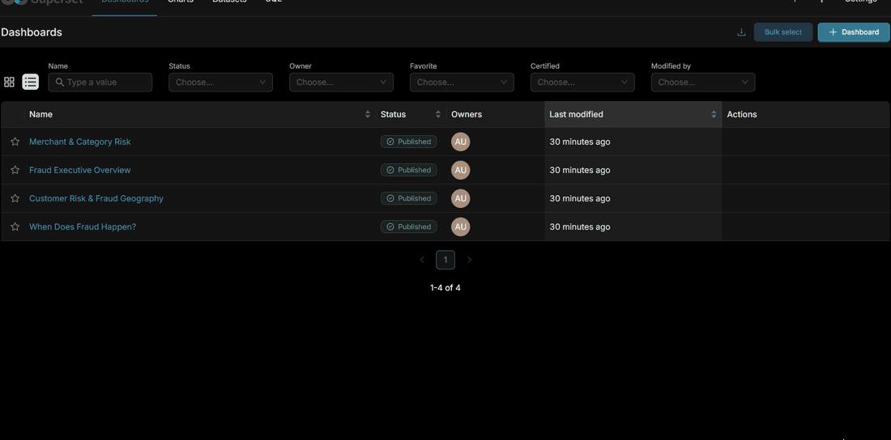
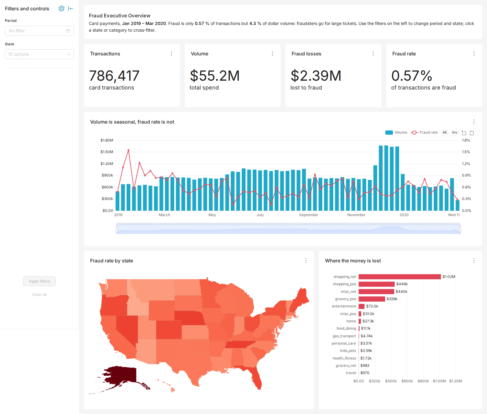
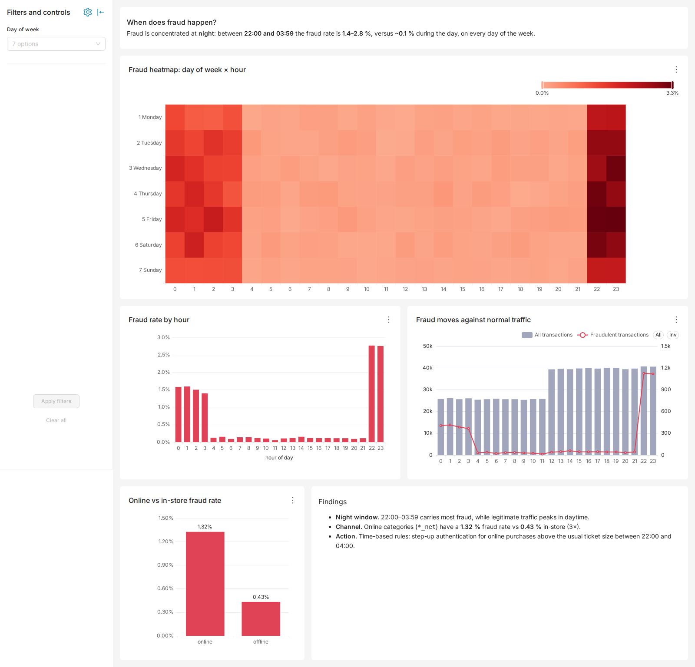
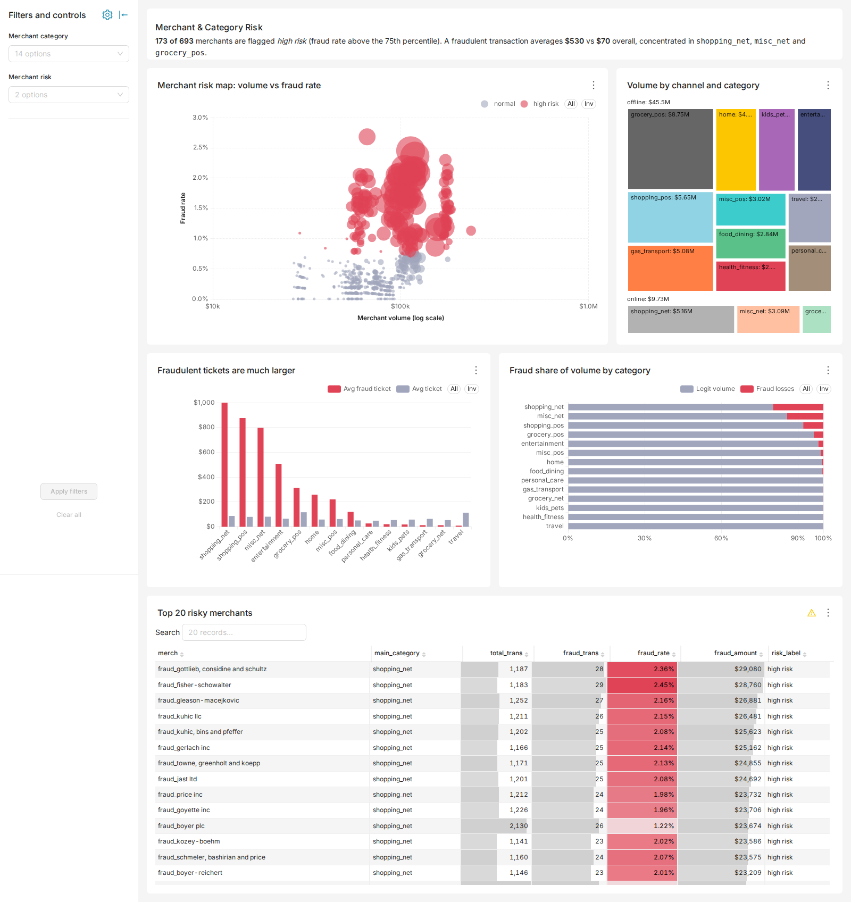
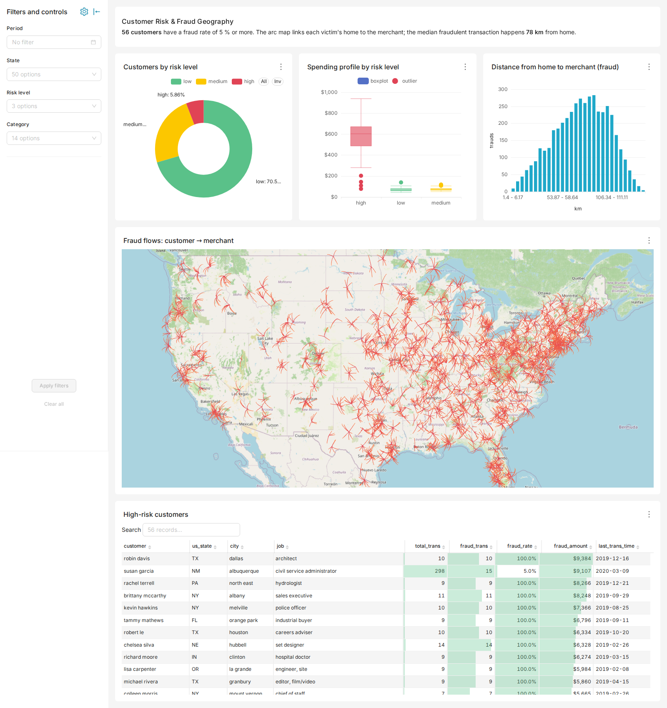
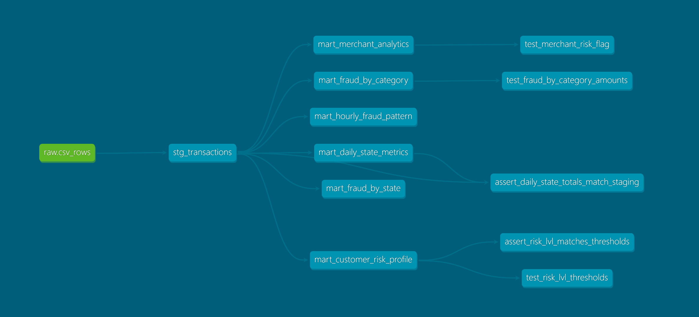

# Fraud Analytics: Kafka → ClickHouse → dbt → Superset

End-to-end аналитика мошеннических карточных транзакций: стриминговая загрузка, витрины на dbt
и BI-дашборды в Superset. Весь стек поднимается локально одной командой через Docker Compose.

**Данные:** 786 тыс. транзакций, январь 2019 – март 2020, 4 504 случая fraud.

## Дашборды



### Fraud Executive Overview
KPI, динамика объёма и fraud rate, карта штатов, потери по категориям.



### When Does Fraud Happen?
Heatmap «день недели × час», fraud rate по часам, online vs offline.



### Merchant & Category Risk
Карта риска мерчантов, структура объёма, размер fraud-чеков, топ рискованных мерчантов.



### Customer Risk & Fraud Geography
Сегментация клиентов по риску, расстояние «дом → мерчант», карта fraud-потоков.



## Архитектура

```
train.csv → producer (Python) → Kafka → ClickHouse (Kafka engine + MV) → dbt (staging → marts) → Superset
```

| Слой | Технологии | Что делает |
|---|---|---|
| Ingestion | Python, Kafka | producer построчно отправляет CSV в топик как JSON |
| Storage | ClickHouse | Kafka engine + materialized view пишут в MergeTree-таблицу с кодеками сжатия |
| Transform | dbt-clickhouse | очистка, нормализация, дедупликация; 7 витрин под задачи BI |
| BI | Apache Superset | 4 дашборда, 21 график, native-фильтры и cross-filtering |

### dbt

Staging-модель очищает и дедуплицирует сырые транзакции. На ней строятся 7 витрин под дашборды:
по штатам, категориям, мерчантам, клиентам, времени суток и география fraud.
Описания всех колонок лежат в [`schema.yml`](dbt/models/schema.yml).



**Качество данных:** 37 тестов (`dbt_utils`, `dbt_expectations`, unit-тесты бизнес-логики,
сверка сумм витрин со staging), линтинг SQL через sqlfluff в pre-commit.

## Запуск

Нужны Docker с Compose и файл `train.csv`.

1. Создайте `.env` из шаблона и заполните пароли и путь до `train.csv`:
   ```bash
   cp .env.example .env
   ```
2. Поднимите сервисы и соберите витрины:
   ```bash
   make up      # kafka, producer, clickhouse, dbt, superset
   make deps    # dbt-пакеты
   make build   # модели и тесты в порядке DAG
   ```
3. Импортируйте дашборды в Superset:
   1. Откройте http://localhost:8088 и войдите как `admin` с паролем `SUPERSET_ADMIN_PASSWORD` из `.env`.
   2. **Dashboards - Import**  - выберите [`superset/dashboards.zip`](superset/dashboards.zip).

Остальные команды: `make run`, `make test`, `make lint`, `make down`. Выбор моделей: `make build s=mart_fraud_by_state`.

## Структура

```
producer/            # Kafka producer: CSV → JSON-сообщения
clickhouse/init/     # таблица, Kafka engine и materialized view
dbt/
  models/staging/    # stg_transactions
  models/marts/      # 7 витрин + unit-тесты
  models/schema.yml  # описания колонок и data-тесты
  tests/             # singular-тесты
  macros/            # segment_by_quantile
superset/
  dashboards.zip     # экспорт дашбордов для импорта через UI
docs/img/            # скриншоты и GIF дашбордов
```
