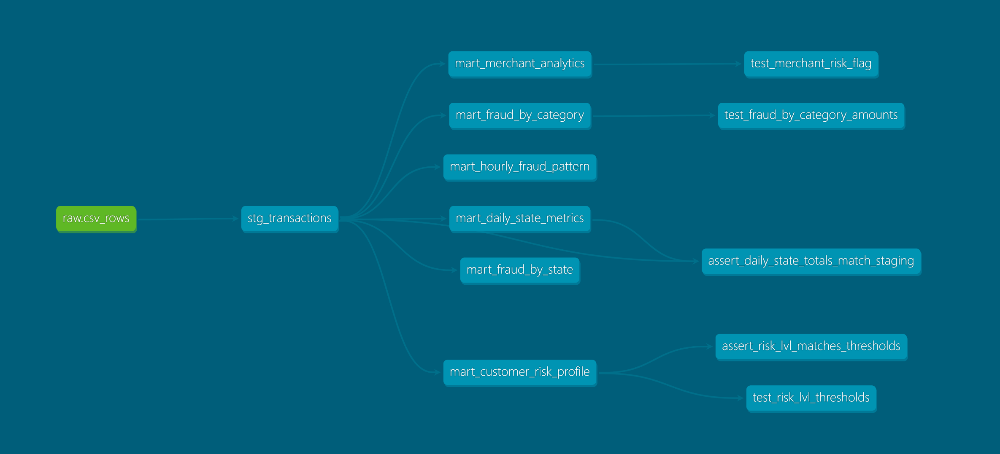

# Fraud transactions: Kafka → ClickHouse → dbt

Стриминговая загрузка транзакций из CSV в ClickHouse через Kafka и аналитические витрины на dbt.

dbt-core=1.10.*; dbt-clickhouse=1.10.3
```
train.csv → producer (Python) → Kafka (csv_rows) → ClickHouse Kafka engine → MV → default.csv_rows → dbt
```

## Структура

```
producer/            # читает train.csv и пишет строки в Kafka как JSON
clickhouse/init/     # таблица csv_rows, Kafka engine и materialized view
dbt/
  models/staging/    # stg_transactions: очистка, нормализация, дедупликация
  models/marts/      # 6 витрин + unit-тесты
  models/schema.yml  # описания колонок и data-тесты
  tests/             # singular-тесты
  macros/            # segment_by_quantile — квантильный сегмент суммы
docker-compose.yaml  # kafka, producer, clickhouse, dbt
Makefile             # основные команды
```

## Запуск

1. Создайте `.env` из шаблона и заполните логин, пароль ClickHouse и путь до `train.csv`:
   ```bash
   cp .env.example .env
   ```
2. Поднимите сервисы и соберите dbt-проект:
   ```bash
   make up      # kafka, producer, clickhouse, dbt
   make deps    # dbt пакеты
   make build   # модели + тесты в порядке DAG
   ```

Остальные команды: `make run`, `make test`, `make lint`, `make fix`, `make down`. Выбор моделей: `make test s=stg_transactions`.

## dbt



| Модель | Гранулярность | Содержание |
|---|---|---|
| `stg_transactions` (view) | транзакция | фильтрация, нормализация строк, `amount_segment`, дедупликация |
| `mart_customer_risk_profile` | клиент | суммы, fraud rate, уровень риска (`risk_thr_*` vars) |
| `mart_daily_state_metrics` | штат × день | число транзакций, суммы, p95, доля крупных |
| `mart_fraud_by_category` | категория | fraud rate, суммы fraud / legit |
| `mart_fraud_by_state` | штат | fraud rate, уникальные мерчанты и клиенты |
| `mart_hourly_fraud_pattern` | день недели × час | fraud rate и сумма по времени |
| `mart_merchant_analytics` | мерчант | fraud rate и флаг риска (> 75-го перцентиля) |

**Тесты**
- staging: `not_null`, `accepted_values`, `dbt_expectations` (уникальность ключа дедупликации, диапазоны `amount` и координат);
- marts: `dbt_utils.unique_combination_of_columns` на гранулярность, диапазоны долей и часов;
- singular: сверка сумм витрины со staging, соответствие `risk_lvl` порогам;
- unit: логика `risk_lvl`, разделение fraud / legit сумм, `risk_flag` мерчантов.

### Логи тестов в test_logs.md

**Качество кода:** sqlfluff (диалект ClickHouse, dbt templater) и pre-commit (`pip install pre-commit && pre-commit install`). Хуки запускают sqlfluff внутри контейнера dbt, поэтому он должен быть запущен.

